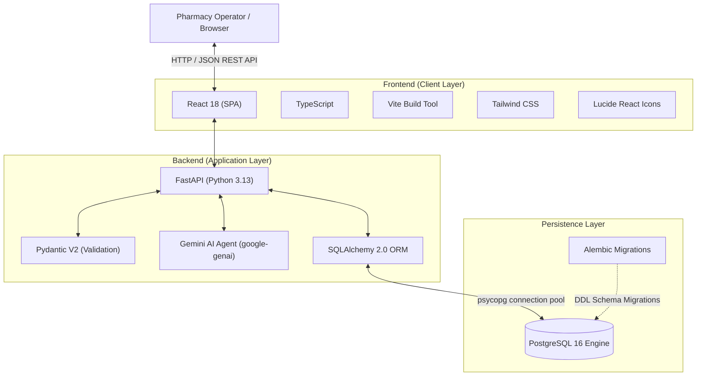
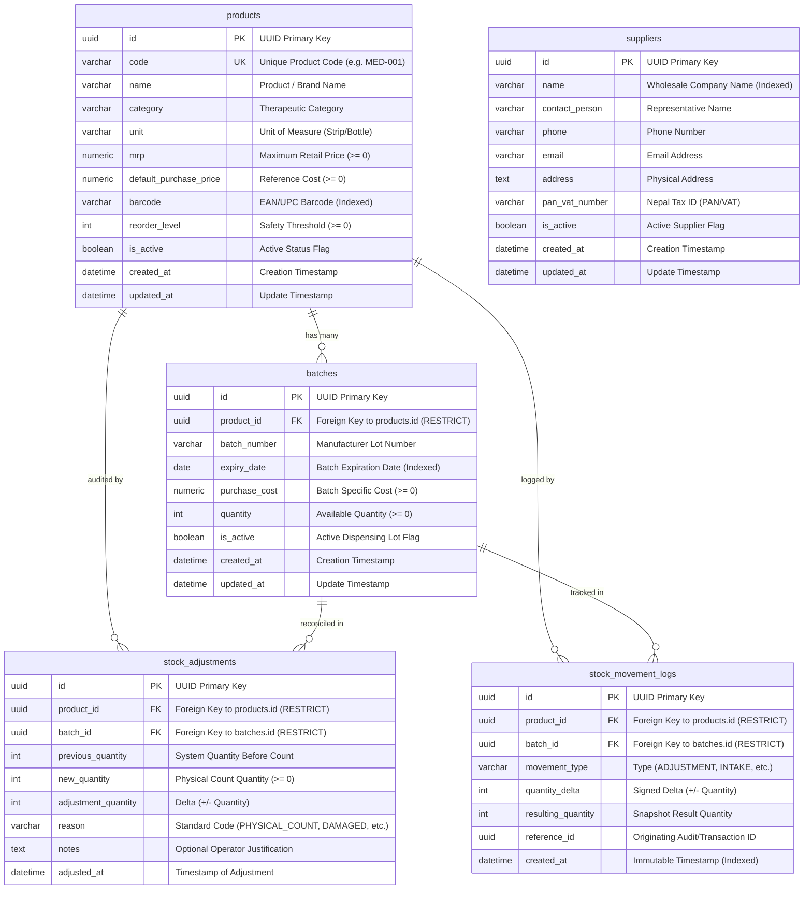
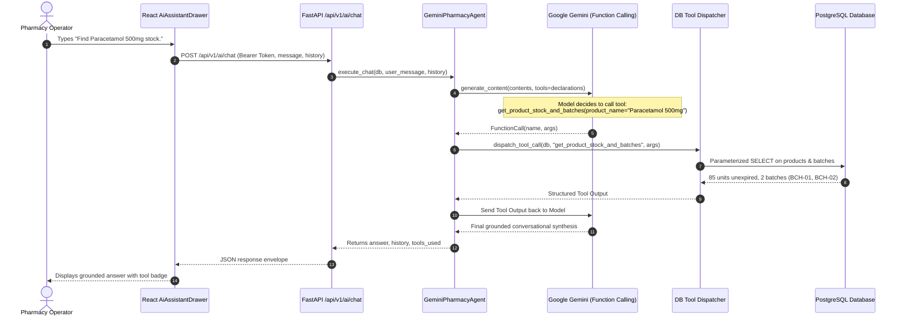

# PharmaKon – First Project Review Comprehensive Preparation Guide

**Project Name:** PharmaKon – Pharmacy Management and Analytics System  
**Client Organization:** Aayushman Pharmacy, Nepal  
**Project Review Stage:** First Project Review (Architecture, Core MVP, Database, and Safety Verification)  
**Date of Review:** November 3, 2026  
**Document Type:** Technical & Defense Preparation Guide  

---

## Table of Contents
1. [Section 1: Project Introduction](#section-1-project-introduction)
2. [Section 2: Problem Statement](#section-2-problem-statement)
3. [Section 3: Proposed Solution](#section-3-proposed-solution)
4. [Section 4: Objectives and Scope](#section-4-objectives-and-scope)
5. [Section 5: Technology Stack](#section-5-technology-stack)
6. [Section 6: System Architecture and Working](#section-6-system-architecture-and-working)
7. [Section 7: Database Design](#section-7-database-design)
8. [Section 8: Implemented Features](#section-8-implemented-features)
9. [Section 9: AI Integration](#section-9-ai-integration)
10. [Section 10: Testing and Verification](#section-10-testing-and-verification)
11. [Section 11: Challenges Faced and Solutions](#section-11-challenges-faced-and-solutions)
12. [Section 12: Current Limitations](#section-12-current-limitations)
13. [Section 13: Future Scope](#section-13-future-scope)
14. [Section 14: Live Demonstration Guide](#section-14-live-demonstration-guide)
15. [Section 15: Questions the Review Panel May Ask (30+ Q&A)](#section-15-questions-the-review-panel-may-ask)
16. [Section 16: Presentation Speaking Script](#section-16-presentation-speaking-script)
17. [Section 17: Quick Revision Sheet](#section-17-quick-revision-sheet)

---

## Section 1: Project Introduction

### 1.1 What is PharmaKon?
**PharmaKon** is an enterprise-grade, client-oriented Pharmacy Management and Operational Intelligence System developed specifically for **Aayushman Pharmacy, Nepal**. It replaces fragmented manual registers and basic retail software with a robust, database-driven web platform designed to enforce **clinical dispensing safety**, **strict batch-level expiry control**, and **automated inventory reconciliation**.

### 1.2 Why is the Project Being Developed?
Retail and institutional community pharmacies handle hundreds of sensitive pharmaceuticals daily. Unlike typical retail goods, medicines possess fixed lifespans, distinct manufacturer batch numbers, and statutory storage/dispensing protocols. Dispensing expired medicines threatens human health, while unmonitored stock expirations cause heavy financial write-offs. PharmaKon bridges the gap between everyday store counter operations and rigorous pharmaceutical safety standards.

### 1.3 Who Uses the System?
1. **Pharmacy Operators / Dispensers:** Counter staff who need instantaneous product catalog searches, FEFO batch prioritization guidance, and real-time stock lookups.
2. **Store Managers / Pharmacists-in-Charge:** Supervisors responsible for physical stock audits, inventory reordering, supplier interactions, and expiry risk monitoring.
3. **Auditors / Business Owners:** Stakeholders reviewing immutable stock movement logs, vendor lists, and operational metrics.

### 1.4 What Makes It Useful for a Pharmacy?
- **Enforces First-Expiry, First-Out (FEFO):** Systematically surfaces the earliest-expiring batch first, minimizing dead stock.
- **Strict Expiry Separation:** Unconditionally excludes expired lots from available dispensing stock, preventing dangerous dispensing mistakes and false low-stock calculations.
- **Auditable Reconciliation:** Physical stock count adjustments produce immutable ledger records (`StockMovementLog`) for clinical and financial compliance.
- **Database-Grounded AI Assistant:** Allows pharmacists to query stock, batch expiry, and supplier details using plain English, backed strictly by parameterized PostgreSQL queries rather than hallucinated LLM responses.

### 1.5 30–45 Second Spoken Introduction (Memorize for Review)
> *"Good morning, respected panel members. My project is **PharmaKon**, a comprehensive Pharmacy Management and Analytics System developed for **Aayushman Pharmacy, Nepal**. In a retail pharmacy, inventory management is not merely a financial task—it is a critical patient safety responsibility. PharmaKon solves the severe industry challenges of medicine expiry wastage and stockouts by implementing strict batch tracking, automated First-Expiry, First-Out (FEFO) dispensing guidance, immutable physical stock audit logs, and a database-grounded AI assistant. The application is built on a modern full-stack architecture using React, TypeScript, FastAPI, and PostgreSQL, backed by 129 passing backend automated regression tests. In this first review, I will present our completed architecture, robust database design, core MVP inventory safety features, and our verification methodology."*

---

## Section 2: Problem Statement

### 2.1 General Pharmacy Industry Challenges
1. **Financial Loss from Unmonitored Expiry:** Medicines sitting unnoticed at the back of pharmacy shelves expire before being sold. Pharmacies typically lose 2% to 5% of their inventory value annually due to expired unsellable medicines.
2. **Dispensing Mistakes:** Under high customer pressure, retail dispensers grab the nearest box rather than the earliest-expiring lot, allowing older batches to expire.
3. **Unexpected Stockouts of Critical Drugs:** Without automated reorder alerts, pharmacies frequently run out of essential emergency drugs and antibiotics.
4. **Fragmented Vendor Data:** Contacting suppliers for urgent replenishments is delayed when distributor phone numbers and PAN/VAT credentials are kept in loose paper books.

### 2.2 Confirmed Client Requirements for Aayushman Pharmacy
Through discussions with Aayushman Pharmacy, the following specific pain points were confirmed:
- **Batch Tracking Necessity:** Every medicine delivery consists of multiple batches with different purchase rates and expiry dates that must be tracked distinctly.
- **Physical Count Discrepancies:** Periodic physical counts reveal damaged vials, broken strips, or count variations that require an auditable adjustment mechanism without corrupting historical logs.
- **Sub-Zero & Boundary Expiry Handling:** Expired medicine stored in quarantine boxes must **never** be counted as available dispensing stock on the computer screen.
- **Fast, Natural Lookups:** Counter staff need rapid operational answers (e.g., *"Do we have Paracetamol 500mg in stock and which batch expires first?"*) without navigating through multi-level complex menus.

---

## Section 3: Proposed Solution

PharmaKon provides an integrated digital platform that couples transactional integrity with proactive operational alerts.

### 3.1 Problem vs. Solution Matrix

| Operational Problem | Traditional / Manual Method | PharmaKon Engineering Solution |
| :--- | :--- | :--- |
| **Medicine Expiry Wastage** | Checking physical strip dates manually during sales. | **FEFO Engine & 30/60/90-Day Expiry Alerts:** Batches sorted automatically by earliest expiry date; visual color-coded urgency badges. |
| **Expired Stock Masking Stockouts** | Total stock calculated by summing all boxes in store, including expired lots. | **Strict Usable Stock Calculation:** Active queries enforce `expiry_date >= date.today()`. Expired stock is isolated and never masks low stock. |
| **Emergency Out-of-Stock** | Realizing a medicine is empty only when a patient presents a prescription. | **Real-Time Low Stock Alerts:** Compares live unexpired product stock against individual product `reorder_level` and computes exact shortfall. |
| **Stock Discrepancy & Shrinkage** | Overwriting database numbers directly with no trail. | **Two-Tier Audit Adjustment:** Updates batch quantity while atomically generating both a `StockAdjustment` record and an immutable `StockMovementLog`. |
| **Vendor Information Bottlenecks** | Paper business cards and physical telephone registers. | **Centralized Supplier Registry:** Dedicated database directory with PAN/VAT tax numbers, primary contact persons, and direct contact details. |
| **Slow Menu Navigation During Rush** | Clicking through 4–5 nested grid screens to check batch dates. | **Database-Grounded AI Assistant:** Natural language operational drawer answering stock and vendor queries via secure, deterministic database tools. |

---

## Section 4: Objectives and Scope

### 4.1 Primary Objectives
1. Implement a normalized, relational database schema in PostgreSQL enforcing ACID transactions, foreign key integrity, and check constraints for products and batches.
2. Develop high-performance RESTful APIs using FastAPI with schema validation (Pydantic V2) and complete error handling.
3. Build a responsive, single-page application (SPA) in React and TypeScript with clear visual status indicators and zero layout shift.
4. Enforce pharmaceutical safety rules: FEFO batch prioritization and absolute exclusion of expired stock from usable inventory.
5. Create an auditable stock adjustment workflow backed by an immutable ledger.
6. Integrate an operational AI Pharmacy Assistant grounded strictly in PostgreSQL via deterministic tool calling.

### 4.2 Secondary Objectives
- Provide one-click demo authentication for frictionless academic review.
- Achieve 100% automated test pass rate for all business logic, database transactions, and error boundaries.
- Maintain production frontend builds with zero TypeScript compilation warnings.

### 4.3 Current MVP Scope (Implemented & Working)
- **Authentication:** Development token-based Bearer authentication (`/api/v1/auth/login`).
- **Dashboard:** Live operational counters, low-stock deficit indicators, expiry alert summaries, and quick navigation.
- **Products Catalog:** Searchable product inventory, category filters, reorder levels, and new product creation.
- **Inventory & Batches:** Multi-batch listing, batch-specific purchase costs, expiry countdowns, and active lot toggles.
- **FEFO Batch Guidance Engine:** Product-level FEFO queue surfacing earliest-expiring lots first.
- **Low Stock Alert Center:** Urgency-ranked listing showing live unexpired stock, reorder thresholds, and exact shortfalls.
- **Expiry Risk Alert Center:** 30-, 60-, and 90-day time-horizon filters with explicit `EXPIRED` and `Expiring Today` badges.
- **Physical Stock Reconciliation:** Dual-record adjustment system with audit reasons and notes.
- **Supplier Directory:** Full CRUD operations for wholesale distributors and pharmaceutical vendors.
- **AI Operational Assistant:** Grounded natural language query engine with 5 allowlisted tools.

### 4.4 Excluded from Current Scope (Explicitly Marked PLANNED)
- **Point of Sale (POS) & Billing:** Live checkout, customer receipts, and automatic stock deduction during retail sale.
- **Purchase Order Invoicing:** Automated GRN (Goods Received Note) processing and supplier invoice generation.
- **Customer Credit Ledger:** Khata / credit tracking for local neighborhood patients.
- **Machine Learning Analytics:** Predictive demand forecasting and seasonal disease trend modeling.

---

## Section 5: Technology Stack

### 5.1 Technology Justification Matrix

| Technology | Role in PharmaKon | Technical Justification | Communication Link |
| :--- | :--- | :--- | :--- |
| **React 18** | Frontend User Interface | Component reusability, virtual DOM diffing, declarative state management for complex multi-tab inventory workflows. | Renders UI in browser; dispatches asynchronous HTTP fetch requests. |
| **TypeScript** | Static Typing | Prevents runtime `undefined` errors across API data boundaries; ensures frontend types mirror FastAPI Pydantic schemas. | Compiles to clean JavaScript via Vite / `tsc`. |
| **Vite** | Frontend Build Tool | Extremely fast Hot Module Replacement (HMR) and optimized Rollup production bundling (< 8s build time). | Bundles frontend modules for production deployment. |
| **Tailwind CSS** | Styling System | Utility-first styling enabling high-density medical dashboard layouts with zero CSS bloat and zero style leakage. | Inlined atomic CSS classes in JSX. |
| **FastAPI** | REST API Backend | High throughput, native async support, automatic OpenAPI/Swagger documentation, and native Pydantic V2 integration. | Exposes JSON endpoints consumed by React frontend. |
| **Pydantic V2** | Request/Response Validation | Rust-accelerated strict payload parsing, query sanitization, and type enforcement before business logic execution. | Validates inbound JSON payloads and serializes responses. |
| **SQLAlchemy 2.0** | Object-Relational Mapper (ORM) | Robust SQL expression language, transaction savepoints, connection pooling, and strict relational mapping. | Translates Python ORM calls into SQL executed against PostgreSQL. |
| **PostgreSQL 16** | Relational Database | ACID compliance, strict foreign key constraints (`ON DELETE RESTRICT`), unique constraints, and check constraints. | Stores all persistent system entities and movement logs. |
| **Alembic** | Database Migration | Version-controlled, deterministic database schema evolution tracking every table and column alteration. | Executes DDL scripts against PostgreSQL. |
| **Google GenAI SDK** | AI Assistant Orchestrator | Official SDK enabling Gemini function calling; dispatches structured tool declarations to the model. | Sends function call requests; receives structured tool arguments. |

---

## Section 6: System Architecture and Working

### 6.1 Frontend Architecture
The frontend is architected as a modular Single Page Application (SPA):
- **Layouts:** [`AppLayout.tsx`](file:///d:/PharmaKon/pharmakon/frontend/src/layouts/AppLayout.tsx) provides a responsive sidebar, operational header station indicator, planned-module pills, and global trigger button for the AI assistant drawer.
- **Features Directory:** Domain-driven directory organization (`features/dashboard`, `features/products`, `features/inventory`, `features/suppliers`, `features/ai`, `features/auth`).
- **API Client:** [`client.ts`](file:///d:/PharmaKon/pharmakon/frontend/src/lib/api/client.ts) wraps standard `fetch` with custom error envelope parsing, authorization header injection, and network error handling.
- **State Management:** Local React hooks (`useState`, `useEffect`, `useCallback`, `useRef`) with strict cleanup patterns to prevent stale closures and duplicate network calls.

### 6.2 Backend Architecture
The backend follows clean layered architecture:
- **API Layer (`app/api/routes`):** Thin HTTP controllers handling route definitions, dependency injection (`Depends(get_db)`, `Depends(get_current_user)`), status codes, and HTTP exceptions.
- **Schema Layer (`app/schemas`):** Pydantic models for request bodies and response envelopes (`ProductCreate`, `BatchResponse`, `StockAdjustmentCreate`, `ChatRequest`).
- **Service Layer (`app/services`):** Pure business logic ([`product_service.py`](file:///d:/PharmaKon/pharmakon/backend/app/services/product_service.py), [`inventory_service.py`](file:///d:/PharmaKon/pharmakon/backend/app/services/inventory_service.py), [`supplier_service.py`](file:///d:/PharmaKon/pharmakon/backend/app/services/supplier_service.py)). All database queries, expiry filters, and calculations reside here.
- **Core Layer (`app/core`):** Database session factory, global settings (`Settings`), and standardized API response wrappers (`success_response`, `AppError`).

### 6.3 End-to-End Request-Response Lifecycle Example
**Scenario:** The user opens the "Low Stock Alerts" tab.
1. **User Action:** React renders `InventoryPage` with `activeTab === 'alerts'`.
2. **Frontend Dispatch:** `inventoryClient.getLowStockAlerts()` sends an authenticated HTTP `GET /api/v1/inventory/alerts/low-stock` with `Authorization: Bearer dev-token-...`.
3. **Route Handling:** FastAPI matches route in [`inventory.py`](file:///d:/PharmaKon/pharmakon/backend/app/api/routes/inventory.py), validates user token via `get_current_user`, and injects a SQLAlchemy session via `get_db`.
4. **Service Execution:** `inventory_service.get_low_stock_alerts(db)` executes:
   - Computes live subquery of total unexpired active stock:
     `SELECT product_id, SUM(quantity) FROM batches WHERE is_active=true AND expiry_date >= CURRENT_DATE GROUP BY product_id`.
   - Joins with `products` where `Product.is_active == True` and `total_stock <= Product.reorder_level`.
   - Orders results by `total_stock ASC` (highest deficit first).
5. **Envelope Serialization:** Backend wraps result in standard JSON envelope: `{"success": true, "data": [...], "message": "Low stock alerts retrieved successfully"}`.
6. **Frontend Update:** React receives data, sets `lowStockAlerts` state, turns off `loading` skeleton, and renders the ranked alert table.

---

## Section 7: Database Design

PharmaKon's persistence layer is designed to 3rd Normal Form (3NF) with explicit check constraints preventing negative inventory or invalid pricing.

### 7.1 Key Database Design Principles in PharmaKon
1. **UUID Primary Keys:** Uses universally unique identifiers (`uuid.uuid4`) preventing sequential enumeration attacks and preparing the system for distributed offline-first sync.
2. **Restrictive Referential Integrity:** All foreign keys specify `ondelete="RESTRICT"`. A product cannot be deleted if batches or audit movement logs exist for it.
3. **Database-Level Integrity Constraints:**
   - `chk_products_mrp_nonnegative`: Ensures retail price is never negative.
   - `chk_batches_quantity_nonnegative`: Guarantees batch stock can never drop below zero at the database engine level.
   - `uq_batches_product_batch_expiry`: Composite unique constraint on `(product_id, batch_number, expiry_date)` preventing accidental double-entry of the same shipment lot.
4. **Performance Indexes:** B-tree indexes placed on `batches.expiry_date`, `products.code`, `products.name`, `products.barcode`, and `stock_movement_logs.created_at` ensure sub-millisecond query performance during rush dispensing.

---

## Section 8: Implemented Features

### 8.1 Dashboard Overview
- **Purpose:** Provide an instant operational health check upon logging in.
- **How It Works:** Queries live database aggregations to present 4 key metrics: Total Catalog Items, Active Tracked Batches, Low Stock Products, and Batches at Expiry Risk (within 60 days).
- **Frontend:** Responsive grid with quick-action shortcuts and an expiry risk preview widget.

### 8.2 Products Catalog Management
- **Purpose:** Master repository of all medicines and healthcare supplies.
- **How It Works:** Lists medicines with pagination, category filtering, and debounced text search (searching name, SKU code, or barcode). Allows adding new medicines with safety reorder levels and pricing.
- **Backend/DB:** Single efficient outer-join query aggregating live active, unexpired batch quantities to show exact total stock per product.

### 8.3 Inventory & Batch Management
- **Purpose:** Granular lot tracking for each medicine.
- **How It Works:** Displays all active batches with manufacturer batch number, unit purchase cost, available quantity, expiry date, and computed days until expiration.
- **Backend/DB:** Orders batches by expiry date by default to encourage store managers to monitor aging lots.

### 8.4 FEFO Batch Guidance Engine
- **Purpose:** Guide counter operators on which exact batch to dispense first to minimize expiration losses.
- **Clinical Safety Rule:** Expired batches (`expiry_date < date.today()`) are **strictly excluded**.
- **Important Review Distinction:** This feature provides **FEFO dispensing recommendation and prioritization queue**. It must be presented as **guidance**, not as a completed transactional sales checkout (since POS billing is a planned Phase 2 module).

### 8.5 Low Stock Alert Center
- **Purpose:** Prevent pharmacy stockouts of critical drugs.
- **How It Works:** Filters all active products where total available unexpired stock is $\le$ `Product.reorder_level`.
- **Urgency Classification:**
  - `OUT_OF_STOCK` (0 units remaining).
  - `CRITICAL` (1 to 2 units remaining).
  - `LOW` (Remaining stock $\le$ reorder level).
- **Sorting:** Strictly sorted by lowest stock first so dispensers address the most severe deficits immediately.

### 8.6 Expiry Risk Alert Center
- **Purpose:** Proactively flag medicines nearing expiration.
- **How It Works:** Allows filtering batches expiring within 30, 60, or 90 days.
- **Safety Distinction:**
  - `EXPIRED` (Negative days until expiry): Prominently badged in red so operators can physically remove and quarantine the lot.
  - `Expiring Today` (0 days): Critical attention badge.
  - `Critical Risk` ($\le 30$ days), `High Priority` ($\le 60$ days), `Moderate` ($\le 90$ days).

### 8.7 Physical Stock Adjustment & Audit Ledger
- **Purpose:** Reconcile differences between system numbers and physical shelf counts (e.g., breakage, spillage, miscounts).
- **How It Works:**
  1. Operator selects product and batch; system automatically fetches and displays the current registered quantity.
  2. Operator enters the newly counted quantity and selects a mandatory standard reason code (`PHYSICAL_COUNT`, `DAMAGED`, `EXPIRED`, `CORRECTION`) with optional remarks.
  3. In a single atomic database transaction:
     - Updates `batches.quantity = new_quantity`.
     - Creates a `StockAdjustment` record.
     - Inserts an immutable `StockMovementLog` capturing `movement_type`, `quantity_delta`, and `resulting_quantity`.
- **Integrity Guarantee:** Physical count can never be set negative; full historical trail is preserved.

### 8.8 Supplier Management
- **Purpose:** Maintain verified distributor contacts for rapid replenishment.
- **How It Works:** Full CRUD interface tracking wholesaler company name, primary contact representative, phone, email, physical address, and Nepal PAN/VAT tax identifier.

### 8.9 Authentication
- **Purpose:** Secure API endpoints and establish user operational context.
- **How It Works:** Bearer token authentication. For academic presentation and frictionless development testing, provides one-click instant login credentials (`operator@aayushman.np` / `operator123`).

---

## Section 9: AI Integration (PharmaKon AI Assistant)

### 9.1 Why AI is Included
Pharmacies are fast-paced environments. Navigating multi-level search forms while serving a patient takes valuable time. The AI assistant allows an operator to ask natural questions like *"Which batches of Amoxicillin expire this month?"* or *"Give me supplier contact details for Meditech"* and receive an instantaneous, verified answer.

### 9.2 The Hallucination Danger in Medical Software
Standard LLMs hallucinate numbers and facts. In a pharmacy, hallucinating medicine stock or an expiry date could lead to patient harm or illegal dispensing. **PharmaKon solves this through Strict Tool Grounding:**
1. **The LLM NEVER accesses raw SQL:** The model cannot run arbitrary queries or modify data.
2. **Strict Allowlist of 5 Deterministic Tools:**
   - `search_products(query, limit)`: Search catalog by name, code, or barcode.
   - `get_product_stock_and_batches(product_name)`: Returns usable stock, active batches in FEFO order, and isolates expired lots.
   - `get_low_stock_medicines()`: Returns products at or below reorder level with shortfalls.
   - `get_expiring_batches(days)`: Returns lots expiring within specified window.
   - `get_supplier_info(name)`: Returns distributor contact and PAN/VAT numbers.
3. **Database Grounding:** The LLM's only job is to understand natural language intent, invoke the correct allowlisted tool, and format the verified PostgreSQL results into clear bullet points.

### 9.3 System Prompt & Safety Rules
The AI agent is bound by [`PHARMAKON_SYSTEM_PROMPT`](file:///d:/PharmaKon/pharmakon/backend/app/services/ai/prompts.py):
- It must state exact batch numbers, quantities, and dates returned by tools.
- If a product is not found, it must explicitly state it was not found—never guess.
- It must clearly distinguish between usable unexpired stock and expired stock.

### 9.4 Verification & Quota Restrictions
- **Zero Live Calls During Evaluation:** To protect student quota and maintain complete determinism, all 46 automated AI tests use mocked responses simulating text turns, tool dispatches, 429 quota exhaustion, timeouts, and multi-turn loops.
- **Model Resolution:** Configured to official production model identifiers (`gemini-2.5-flash`, fallback: `gemini-2.0-flash`, `gemini-1.5-flash`).

---

## Section 10: Testing and Verification

PharmaKon has undergone rigorous automated testing across the entire stack.

### 10.1 Latest Verified Test Metrics (November 3, 2026)

| Test Layer | Test Framework | Test Count | Result | Scope Verified |
| :--- | :--- | :---: | :---: | :--- |
| **Backend Unit & Integration** | `pytest` | **129 passed** | **100% Pass** | Models, constraints, services, REST APIs, error envelopes, and DB isolation. |
| **Backend AI Agent & Tools** | `pytest` + `unittest.mock` | **46 passed** | **100% Pass** | Tool execution, allowlist enforcement, parameter clamping, 429 quota handling. |
| **Frontend Component Tests** | `vitest` | **10 passed** | **100% Pass** | Currency formatters, Login form, AI drawer interactions, token persistence. |
| **TypeScript Static Check** | `tsc -b` | Clean | **0 Errors** | Static type safety across all React components and API payloads. |
| **Production Bundle** | Vite / Rollup | Clean | **Succeeded (7.64s)** | Production distribution build (`dist/`) generated without warnings. |

### 10.2 Landmark Clinical Safety Test: Medicine A Scenario
In [`test_inventory.py`](file:///d:/PharmaKon/pharmakon/backend/tests/test_inventory.py), a dedicated business logic test verifies the core safety invariant:
- **Scenario:** Product "Medicine Safety A" has a reorder level of 15.
  - **Batch A:** 20 units (Expired 5 days ago).
  - **Batch B:** 5 units (Valid for 90 days).
- **Verified Assertions:**
  1. Usable stock is calculated as **5 units** (not $20 + 5 = 25$).
  2. Product **MUST appear in Low Stock Alerts** because $5 \le 15$ with a shortfall of 10 units.
  3. FEFO Dispensing API returns **ONLY Batch B**. Expired Batch A is completely omitted.
  4. Expiry Risk Alerts flags Batch A with urgency **`EXPIRED`**.
  5. AI inventory tools report `total_stock = 5` and `expired_stock = 20`.

> **Academic Note:** Passing 129 automated tests demonstrates that all tested logic, constraints, and error handlers execute as designed. In professional engineering, automated tests provide a strong regression safety net, while ongoing production monitoring remains essential.

---

## Section 11: Challenges Faced and Solutions

### 1. Dual React Render / Screen Flashing Bug
- **Symptom:** Visiting the Inventory section caused the screen to flash twice.
- **Root Cause:** React 18 Strict Mode mounts components twice in development. Two separate `useEffect` hooks triggered redundant parallel `GET` calls to `/api/v1/inventory/batches` and `/api/v1/products`, triggering back-to-back state updates and re-renders.
- **Solution:** Consolidated initial data loading into a single coordinated fetch with active boolean guards (`isMounted`) and proper cleanup functions.

### 2. Expired Stock Masking Critical Stockouts
- **Symptom:** Medicines with large expired batches were omitted from low-stock warnings even though zero usable units were left for patients.
- **Root Cause:** SQL `func.sum(Batch.quantity)` filtered only `is_active == True` without verifying `expiry_date >= date.today()`.
- **Solution:** Updated all SQL subqueries in [`product_service.py`](file:///d:/PharmaKon/pharmakon/backend/app/services/product_service.py), [`inventory_service.py`](file:///d:/PharmaKon/pharmakon/backend/app/services/inventory_service.py), and [`tools.py`](file:///d:/PharmaKon/pharmakon/backend/app/services/ai/tools.py) to add `Batch.expiry_date >= date.today()`.

### 3. AI Assistant Generic 500 Error
- **Symptom:** Querying the AI Assistant produced a red banner: *"Assistant Error: An error occurred while communicating with the AI service."*
- **Root Cause:** The environment and fallback candidate list contained fictitious model identifiers (`gemini-3.1-flash-lite`, `gemini-3.5-flash`), causing Google's API to return HTTP 404 (Model Not Found) across all attempts.
- **Solution:** Updated configuration and fallback lists to official Google models (`gemini-2.5-flash`, `gemini-2.0-flash`, `gemini-1.5-flash`) and improved error differentiation for rate limits (429) vs. timeouts (504).

### 4. Database Foreign Key Integrity Violations
- **Symptom:** Attempting to delete a product or batch could leave orphaned audit logs or crash the system.
- **Root Cause:** Default database cascades could delete financial and clinical audit history.
- **Solution:** Enforced `ondelete="RESTRICT"` across all foreign keys and added composite unique constraints to guarantee that audit movement logs remain permanent and tamper-proof.

---

## Section 12: Current Limitations

To demonstrate technical maturity to your review panel, openly acknowledge current MVP boundaries:

1. **Development Authentication:** Current authentication uses pre-configured development tokens (`dev-token-...`) for frictionless evaluation. It lacks bcrypt password hashing, JWT expiration signatures, and refresh token rotation.
2. **FEFO Dispensing Guidance vs. POS Execution:** The system calculates and displays the correct FEFO batch order, but does not yet have a retail checkout screen to automatically deduct batch quantities during a sale.
3. **Gemini Free-Tier Quota:** Google Gemini's free API tier imposes strict limits (15 requests/minute, daily caps). High volume requires an enterprise API tier or local open-source LLM fallback.
4. **Planned Modules (Currently Out of Scope):**
   - Point of Sale (POS) and customer billing.
   - Purchase Orders and Goods Received Notes (GRN).
   - Customer Credit Ledger (Khata).
   - Machine Learning-based demand forecasting.

---

## Section 13: Future Scope

### Phase 2: Commercial Retail & Billing Engine
- **Point of Sale (POS) Interface:** High-speed barcode-scanner-driven billing screen that automatically deducts stock from the earliest-expiring batch atomically.
- **Thermal Receipt Printing:** Generating VAT-compliant customer invoices with batch numbers and expiry dates printed on each line.
- **Purchase Order & GRN Processing:** Inward stock entry module that updates batch purchase costs and supplier ledgers upon delivery.

### Phase 3: Analytics & Machine Learning
- **Demand Forecasting:** Applying ARIMA / XGBoost on historical dispensing data to forecast seasonal medicine requirements (e.g., higher antihistamine and paracetamol demand during monsoon season in Nepal).
- **Smart Reorder Optimization:** Automatically generating purchase order drafts based on supplier lead times and average daily consumption.

### Phase 4: Enterprise Security & Cloud Infrastructure
- **Production RBAC & OAuth2:** Role-Based Access Control separating Chief Pharmacist, Dispensing Cashier, and Store Auditor roles with signed JWTs.
- **Offline-First Synchronization:** Local PWA caching to allow uninterrupted counter sales during internet disruptions, syncing with central PostgreSQL when reconnected.

---

## Section 14: Live Demonstration Guide (5–7 Minutes)

Follow this structured, reliable demonstration flow during your review:

| Step | Page / Component | Action to Perform | What to Show / Explain to Panel | Technical Concept |
| :---: | :--- | :--- | :--- | :--- |
| **1** | **Login Page** | Click *"Quick Fill Demo Credentials"* $\rightarrow$ Click *"Sign In"*. | Explain Bearer token authentication and role-based session initialization. | Auth state management, token storage. |
| **2** | **Dashboard** | View operational KPI cards and Expiry Risk tracker. | Highlight the 4 real-time counters and explain that all numbers are computed dynamically from PostgreSQL. | Relational aggregations, zero hardcoding. |
| **3** | **Products Catalog** | Type `"Para"` in the search box; filter by category. | Show instant debounced search across name, code, and barcode. Note the `Total Stock` column. | SQL subqueries, debounced input. |
| **4** | **Inventory: Batches** | Click *"Inventory & FEFO"* $\rightarrow$ Tab 1: *"All Active Batches"*. | Point out distinct batch numbers (`BCH-2026-01`, `BCH-2026-02`), individual expiry dates, and countdown days. | 1-to-many product-batch relationship. |
| **5** | **Inventory: FEFO** | Switch to Tab 2: *"FEFO Dispensing Engine"* $\rightarrow$ Select `Paracetamol 500mg`. | **Crucial Demo:** Show how the system ranks Batch BCH-2026-01 first because it expires earlier (Nov 2026 vs May 2027). | First-Expiry, First-Out clinical guidance. |
| **6** | **Inventory: Alerts** | Switch to Tab 3: *"Low Stock Alerts"* & Tab 4: *"Expiry Risk Alerts"*. | Explain the clinical safety rule: Expired stock is isolated and never masks a low-stock alert. Show `EXPIRED` badge. | Automated threshold evaluation, safety filter. |
| **7** | **Stock Adjustment** | Switch to Tab 5: *"Physical Stock Adjustment"* $\rightarrow$ Select a batch $\rightarrow$ Adjust quantity by $+2$ with reason `PHYSICAL_COUNT`. | Submit the form. Show the toast notification and immediate update in the audit trail table below. | Atomic transaction, dual audit log creation. |
| **8** | **Suppliers** | Click *"Suppliers"* in sidebar. | Show supplier directory with Nepal PAN/VAT tax numbers and direct phone contacts. | CRUD architecture, relational modeling. |
| **9** | **AI Assistant** | Click the floating *"AI Assistant"* pill in the header. | Point out the "PostgreSQL Grounded" badge. Explain how tool calling dispatches allowlisted queries instead of raw SQL. | Function calling, database grounding, security. |

---

## Section 15: Questions the Review Panel May Ask (30+ Q&A)

### Category A: Project Conception & Problem Domain
1. **Q: Why did you choose to build a pharmacy management system instead of a generic inventory system?**  
   *A:* Pharmaceuticals have strict clinical and legal constraints that generic inventory systems do not support—specifically discrete batch tracking, manufacturer expiry dates, statutory FEFO dispensing protocols, and clinical stockout alerts.
2. **Q: What is FEFO, and why is it preferred over FIFO in a pharmacy?**  
   *A:* FIFO (First In, First Out) dispenses the oldest purchased stock. FEFO (First Expiry, First Out) dispenses the batch that expires earliest, regardless of when it arrived at the store. In pharmacy, a batch received yesterday might expire sooner than one received last week; hence FEFO is mandatory to prevent medicine expiration.
3. **Q: How does your system prevent dispensing expired medicines?**  
   *A:* All dispensing guidance queries explicitly filter `Batch.expiry_date >= date.today()`. Expired batches are flagged with an `EXPIRED` status for quarantine and cannot appear in FEFO recommendations.

### Category B: Architecture & Database Design
4. **Q: Why did you choose FastAPI over Django or Flask?**  
   *A:* FastAPI offers asynchronous performance, native type-hinting integration with Pydantic V2, high throughput for counter dispensing, and automatic generation of interactive OpenAPI documentation.
5. **Q: Why did you choose PostgreSQL over MySQL or MongoDB?**  
   *A:* PostgreSQL provides robust ACID compliance, superior support for check constraints, strong transactional isolation, and advanced subquery optimization crucial for live multi-batch stock calculations.
6. **Q: Why are you using UUIDs instead of auto-incrementing integers for primary keys?**  
   *A:* UUIDs prevent sequential enumeration attacks and prepare PharmaKon for future offline-first desktop/mobile clients that need to generate transaction keys without central database collisions.
7. **Q: What does `ondelete="RESTRICT"` do in your foreign keys?**  
   *A:* It prevents accidental deletion of master records. For example, if a store manager attempts to delete a product that has existing batches or audit logs, the database engine rejects the deletion, protecting financial integrity.
8. **Q: Explain the difference between `StockAdjustment` and `StockMovementLog`.**  
   *A:* `StockAdjustment` is an operational record capturing the operator's reason and notes for a physical shelf count. `StockMovementLog` is a universal, immutable ledger recording every single positive or negative delta across all system modules.
9. **Q: How is the total stock of a product calculated?**  
   *A:* Rather than storing a static counter that can drift out of sync, total stock is dynamically computed using a SQL subquery summing `quantity` from all active batches where `expiry_date >= CURRENT_DATE`.

### Category C: Frontend & Implementation
10. **Q: Why did you choose React with TypeScript rather than plain JavaScript?**  
    *A:* TypeScript enforces static typing at compile time, catching null pointer exceptions and ensuring that our frontend interfaces exactly match FastAPI's Pydantic response models.
11. **Q: How do you prevent unnecessary re-renders in your inventory dashboard?**  
    *A:* We consolidate API requests into coordinated functions, use `useCallback` for stable event handler references, and maintain proper cleanup flags in `useEffect` hooks.
12. **Q: What is Vite and why did you choose it over Create React App?**  
    *A:* Vite uses native ES modules during development for near-instantaneous hot module replacement (HMR) and Rollup for optimized production builds, compiling our entire frontend in under 8 seconds.

### Category D: AI Assistant & Security
13. **Q: Can your AI assistant execute arbitrary SQL queries on PostgreSQL?**  
    *A:* Absolutely not. The LLM has zero direct database connectivity. It communicates exclusively through 5 predefined Python functions with strict argument validation and parameterized SQLAlchemy queries.
14. **Q: What happens if the AI model hallucinates a batch number?**  
    *A:* The system architecture makes this impossible in data retrieval: the model must call `get_product_stock_and_batches` or `search_products`, which fetch verified rows directly from PostgreSQL. The model only formats the returned database output.
15. **Q: What is Function Calling in Google Gemini?**  
    *A:* Function calling is a structured protocol where the developer describes available tools using JSON schemas. The model analyzes user intent and returns a structured JSON object specifying which function to run and with what arguments, rather than answering with unverified text.
16. **Q: How does your AI Assistant handle Google API rate limits (HTTP 429)?**  
    *A:* If the Gemini API returns a 429 quota exhaustion or timeout, our backend intercepts the error, prevents crashes, and returns a clear, professional operational alert advising the user of quota limits.
17. **Q: Why did you mock AI responses during automated testing?**  
    *A:* Testing against live external APIs consumes paid quota, introduces network latency, and causes non-deterministic test failures. Mocking verifies our agent orchestration, tool routing, and error handling with 100% reliability.

### Category E: Testing & Verification
18. **Q: How many automated tests exist in the project, and what do they test?**  
    *A:* We have **129 backend tests** in pytest (covering ORM models, constraints, API routes, database sessions, and AI tools) and **10 frontend tests** in Vitest, all passing with zero errors.
19. **Q: Explain the "Medicine Safety A" test scenario.**  
    *A:* We created a product with reorder level 15, having 20 expired units and 5 valid units. The test verifies that available stock is strictly 5, the product is flagged as low-stock (shortfall of 10), and the expired batch is never recommended for dispensing.
20. **Q: Does a 100% test pass rate mean the application has no bugs?**  
    *A:* No. Passing 129 tests proves that all implemented features adhere to our written specifications, boundary conditions, and regression suites. Real-world usage requires continuous user feedback and staging tests.

### Category F: Advanced Technical & Operational Questions
21. **Q: How do you handle database migrations?**  
    *A:* We use Alembic to maintain version-controlled migration scripts, ensuring that all table alterations, constraints, and indexes can be deterministically applied across development, testing, and production databases.
22. **Q: What is an N+1 query problem, and how did you avoid it?**  
    *A:* The N+1 problem occurs when fetching a list of $N$ products triggers $N$ separate queries to fetch batch stock. We eliminated this by computing batch stock in a single SQL subquery joined directly to the `products` table.
23. **Q: What prevents a user from adjusting stock to a negative number?**  
    *A:* Two independent layers: Pydantic schema validation (`ge=0` on `new_quantity`) and database-level check constraints (`chk_stock_adjustments_new_quantity_nonnegative`).
24. **Q: Why is the Sales / POS module currently marked as PLANNED?**  
    *A:* We adopted a disciplined engineering strategy: establish a bulletproof inventory, batch, and safety core first. A POS module built on an unverified stock engine risks selling non-existent or expired drugs.
25. **Q: How is Nepal-specific tax compliance accounted for?**  
    *A:* The `Supplier` entity includes dedicated fields for Nepal PAN/VAT registration numbers, and products track MRP (Maximum Retail Price) which is statutory in Nepal.
26. **Q: What HTTP status codes does your API return on errors?**  
    *A:* `400 Bad Request` for invalid business logic, `401 Unauthorized` for missing/bad tokens, `404 Not Found` for non-existent records, `422 Unprocessable Content` for Pydantic validation failures, `429 Too Many Requests` for rate limits, and `504 Gateway Timeout` for upstream timeouts.
27. **Q: What is the purpose of the `uq_batches_product_batch_expiry` constraint?**  
    *A:* It prevents duplicate inventory lots. The same product cannot have two records with identical batch numbers and expiry dates; new deliveries of that batch must update quantity rather than duplicating rows.
28. **Q: How does the system handle database transaction rollbacks during failures?**  
    *A:* All transactional write operations (such as physical stock adjustments) execute within a SQLAlchemy context block. If any step fails, `db.rollback()` executes automatically, leaving the database in a consistent state.
29. **Q: What security practices are followed for environment secrets?**  
    *A:* All credentials (`DATABASE_URL`, `GEMINI_API_KEY`) are stored in `.env` which is excluded from version control via `.gitignore`. Sample templates are provided in `.env.example`.
30. **Q: What is your plan for production deployment?**  
    *A:* Containerization using Docker (multi-stage Dockerfile for FastAPI backend and Nginx for static frontend assets), backed by a managed PostgreSQL instance with daily automated backups.

---

## Section 16: Presentation Speaking Script

Use this natural script during your presentation slides:

### Slide 1: Title & Introduction
> *"Respected panel members, welcome to my first project review presentation for **PharmaKon**, a client-oriented Pharmacy Management and Analytics System built for **Aayushman Pharmacy, Nepal**. My name is [Your Name], and I look forward to walking you through our engineering solution."*

### Slide 2: The Core Problem
> *"In a community pharmacy, managing inventory is fundamentally different from a standard retail grocery store. When a medicine expires on the shelf, it represents both a total financial write-off and a serious patient safety hazard. In our study with Aayushman Pharmacy, we identified three critical operational challenges: first, the lack of automated First-Expiry, First-Out (FEFO) dispensing guidance; second, stockout blindspots where expired medicines falsely mask low inventory; and third, the absence of an immutable audit trail when physical stock discrepancies occur."*

### Slide 3: Our Proposed Solution & MVP Scope
> *"PharmaKon solves these problems through an integrated full-stack web system. Our current MVP establishes a clinical safety core: granular batch tracking, automated FEFO guidance, threshold-driven low-stock and expiry alerts, an auditable physical stock adjustment ledger, a verified supplier registry, and a database-grounded AI assistant. Notice that we have deliberately prioritized building a robust, mathematically sound inventory foundation before implementing the retail sales checkout."*

### Slide 4: Technology Stack & Architecture
> *"Our architecture follows a decoupled, three-tier model. On the frontend, we use React 18 with TypeScript and Vite for static type safety and fast rendering. The frontend communicates via authenticated REST APIs with a high-performance Python FastAPI backend. For data persistence, we utilize PostgreSQL 16 managed through SQLAlchemy 2.0 ORM and Alembic migrations. All data operations enforce ACID transactions and strict foreign key constraints."*

### Slide 5: Database Design & Invariants
> *"Our database schema consists of 5 normalized entities: Products, Batches, Suppliers, Stock Adjustments, and Stock Movement Logs. To guarantee clinical safety at the database level, we enforce check constraints preventing negative quantities or negative retail prices, and composite unique constraints on batch numbers. When a stock adjustment occurs, the system atomically updates the batch quantity while inserting both an adjustment audit record and an immutable movement log."*

### Slide 6: The AI Operational Assistant
> *"A key innovation in PharmaKon is our AI Pharmacy Assistant powered by Google Gemini. To eliminate AI hallucinations in medical operations, our agent uses a strict function-calling architecture. The LLM has zero direct database access. Instead, it dispatches one of 5 allowlisted Python tools that execute parameterized SQLAlchemy queries. The model receives verified PostgreSQL data and synthesizes clear, conversational answers for the dispenser."*

### Slide 7: Testing & Verification
> *"Engineering rigor has been our highest priority. The backend is protected by **129 passing automated pytest tests**, including a dedicated clinical safety test confirming that expired batches are unconditionally excluded from usable stock. Our frontend contains 10 component tests in Vitest and builds with zero TypeScript errors in 7.64 seconds. All AI automated tests are 100% mocked to guarantee deterministic evaluation."*

### Slide 8: Future Roadmap & Conclusion
> *"In Phase 2, we will build upon this verified inventory core to introduce our Point of Sale billing engine with automated stock deduction, followed by predictive demand forecasting in Phase 3. In summary, PharmaKon transforms everyday pharmacy operations from reactive record-keeping into proactive, clinical safety enforcement. Thank you, and I am now ready for your questions."*

---

## Section 17: Quick Revision Sheet (Last-Minute Review)

### 1-Minute Pitch
PharmaKon is a full-stack pharmacy management system built for Aayushman Pharmacy, Nepal, using React, TypeScript, FastAPI, and PostgreSQL. It enforces patient safety through batch-level tracking, First-Expiry, First-Out (FEFO) dispensing guidance, strict exclusion of expired stock, two-tier stock audit logs, and an AI operational assistant grounded in deterministic database queries.

### 10 Critical Technical Facts
1. **Frontend:** React 18 + TypeScript + Vite + Tailwind CSS.
2. **Backend:** FastAPI (Python 3.13) + Pydantic V2 + SQLAlchemy 2.0.
3. **Database:** PostgreSQL 16 (UUID primary keys, `ON DELETE RESTRICT`, check constraints).
4. **Usable Stock Formula:** $\sum \text{quantity}$ where `is_active == True` AND `expiry_date >= date.today()`.
5. **FEFO Rule:** Earliest expiring lot is always prioritized for dispensing.
6. **Stock Adjustment:** Atomically updates `Batch.quantity`, creates `StockAdjustment`, and writes immutable `StockMovementLog`.
7. **AI Security:** LLM has zero direct SQL access; uses Gemini function calling with 5 allowlisted deterministic tools.
8. **AI Model:** Configured to official `gemini-2.5-flash` with graceful 429 quota and timeout handling.
9. **Test Metrics:** 129 backend tests passing (pytest), 10 frontend tests passing (Vitest), clean build in 7.64s.
10. **Scope Clarity:** FEFO is currently an operational **guidance queue**; POS retail sales deduction is planned for Phase 2.

### Summary of Database Entities
- `products`: Master medicine records with SKU codes, barcodes, and reorder levels.
- `batches`: Discrete inventory shipments with lot numbers, purchase costs, and expiry dates.
- `suppliers`: Wholesaler registry with Nepal PAN/VAT tax numbers and contact info.
- `stock_adjustments`: Human-readable audit records of physical inventory counts.
- `stock_movement_logs`: Immutable ledger tracking every signed quantity delta across the system.

### Core API Endpoints
- `POST /api/v1/auth/login`: Issue development Bearer session token.
- `GET /api/v1/products`: List/search products with live calculated stock.
- `GET /api/v1/inventory/batches`: List batches sorted in FEFO order.
- `GET /api/v1/inventory/fefo/{product_id}`: Retrieve unexpired FEFO dispensing queue.
- `GET /api/v1/inventory/alerts/low-stock`: Retrieve products at or below reorder level.
- `GET /api/v1/inventory/alerts/expiry-risk?days=60`: Retrieve batches expiring within window.
- `POST /api/v1/inventory/adjustments`: Record physical stock count and write audit logs.
- `POST /api/v1/ai/chat`: Authenticated natural language query endpoint.

### Top 5 Challenges & Solutions
1. **Double Screen Flash:** Solved by consolidating `useEffect` fetches and using active mounting guards.
2. **Expired Stock Masking Stockouts:** Solved by enforcing `expiry_date >= date.today()` across all stock subqueries.
3. **AI Generic 500 Error:** Solved by correcting model identifiers to `gemini-2.5-flash` and handling 429 quota exhaustion.
4. **Data Integrity Risks:** Solved with `ON DELETE RESTRICT` and non-negative database check constraints.
5. **N+1 SQL Queries:** Solved by replacing iterative batch queries with a single aggregated outer-join subquery.

### Top 10 Questions You Must Answer Confidently
1. *What is FEFO and why does a pharmacy need it?* (Earliest expiry dispensed first to minimize dead stock).
2. *Can your AI assistant hallucinate medical inventory?* (No, it is strictly grounded in PostgreSQL via 5 allowlisted Python tools).
3. *How is total product stock calculated?* (Dynamically summed across active, unexpired batches).
4. *What happens to expired medicines in your system?* (Excluded from usable stock and FEFO; surfaced in Expiry Alerts as EXPIRED for quarantine).
5. *Why is the POS module not in this review?* (We prioritized verifying a bulletproof inventory and safety foundation first).
6. *Why did you choose FastAPI over Django?* (Async speed, Pydantic V2 typing, and native OpenAPI specs).
7. *How are physical stock adjustments audited?* (Atomically generates both a `StockAdjustment` record and an immutable `StockMovementLog`).
8. *What database engine do you use and why?* (PostgreSQL for ACID compliance, check constraints, and relational integrity).
9. *How do you test your AI integration without burning API quota?* (100% mocked responses in automated pytest suites).
10. *What are your test numbers?* (129 backend tests passing, 10 frontend tests passing, clean TypeScript build).
